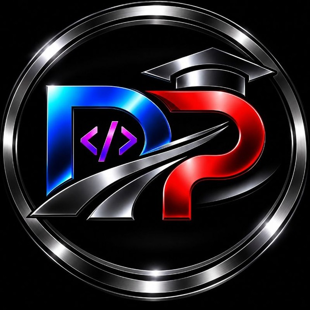

# DevLearnPath

### Learn the path. Build the future.

**Software Development · Engineering Tools · Application Development**

[Website](https://YOUR-DOMAIN) · [Repositories](https://github.com/YOUR-USERNAME?tab=repositories) · [Email](mailto:YOUR-EMAIL)

---

## About

**DevLearnPath** is a technology and project-services brand focused on building practical digital solutions and supporting technical projects.

The brand brings together software development, application development, engineering tools, and academic project support. This GitHub profile is the home for source code, experiments, documentation, and selected portfolio projects.

## Focus Areas

| Area | Topics |
|---|---|
| Full-stack Development | Web applications, front-end, back-end, APIs |
| Application Development | Useful tools and software applications |
| Engineering & Technical Tools | COMSOL, MATLAB, GIS, SketchUp, AutoCAD |
| Learning & Digital Skills | ICDL and **سایر پروژه‌های دانشگاهی** |

## Technology Stack

## 🧠 Technologies & Technical Skills

### 💻 Software Development

  

### ⚙️ Engineering & Technical Software

  

- COMSOL
- MATLAB
- GIS
- SketchUp
- AutoCAD
- ICDL

### 🚀 Development Areas

- Software Engineering
- Full-Stack Development
- Backend Development
- Web Application Development
- API Development
- Application Development
- Artificial Intelligence

### 🔮 Future Technologies

Expanding the technology stack with new tools,
frameworks and engineering technologies.

## Project Workflow

1. **Request** — Define the project goal, category, requirements, files, and preferred deadline.
2. **Review** — Review the requirements and clarify missing details.
3. **Proposal** — Agree on scope, schedule, and estimated cost before starting.
4. **Agreement** — Confirm the working terms and payment arrangement.
5. **Development** — Build the agreed solution and communicate progress.
6. **Delivery** — Deliver the agreed files and outputs.
7. **Guidance** — Provide relevant setup, usage, or handover guidance.

## Featured Repositories

> Replace these examples with real repositories when you publish your projects. Do not leave placeholder links in the final public profile.

- **[Project One](https://github.com/YOUR-USERNAME/PROJECT-ONE)** — Briefly explain the problem, your solution, and the main technologies.
- **[Project Two](https://github.com/YOUR-USERNAME/PROJECT-TWO)** — Briefly explain the problem, your solution, and the main technologies.
- **[Project Three](https://github.com/YOUR-USERNAME/PROJECT-THREE)** — Briefly explain the problem, your solution, and the main technologies.

## Connect

- **Website:** https://YOUR-DOMAIN
- **Email:** [YOUR-EMAIL](mailto:YOUR-EMAIL)
- **Telegram:** @YOUR-TELEGRAM
- **Instagram:** https://instagram.com/YOUR-INSTAGRAM
- **LinkedIn:** https://linkedin.com/in/YOUR-LINKEDIN
- **WhatsApp:** https://wa.me/YOUR-PHONE_WITH_COUNTRY_CODE

---

**DevLearnPath — Learn the path. Build the future.**

<!--
**AliMalekiDLP/AliMalekiDLP** is a ✨ _special_ ✨ repository because its `README.md` (this file) appears on your GitHub profile.

Here are some ideas to get you started:

- 🔭 I’m currently working on ...
- 🌱 I’m currently learning ...
- 👯 I’m looking to collaborate on ...
- 🤔 I’m looking for help with ...
- 💬 Ask me about ...
- 📫 How to reach me: ...
- 😄 Pronouns: ...
- ⚡ Fun fact: ...
-->
